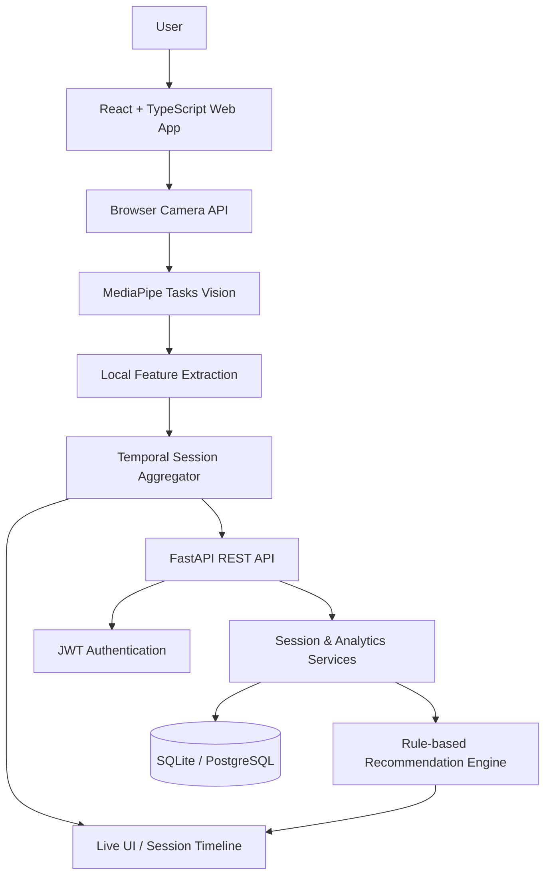
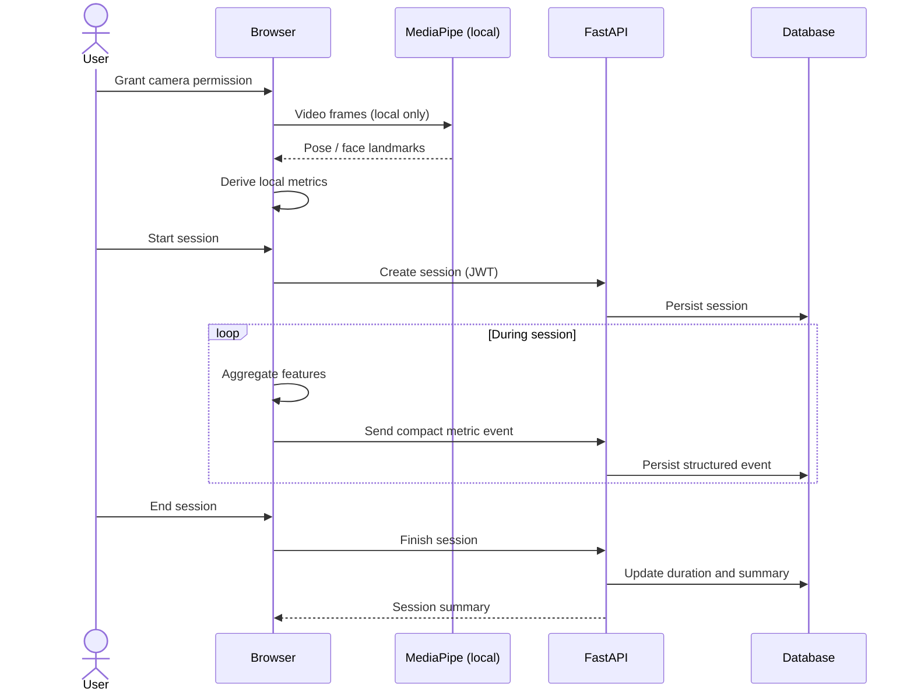
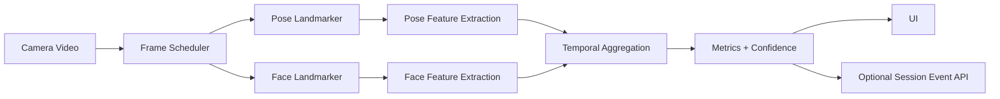
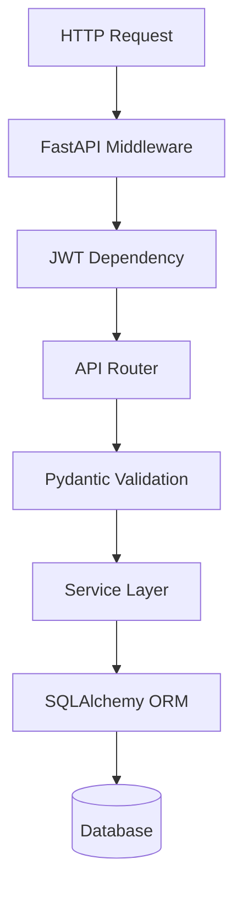
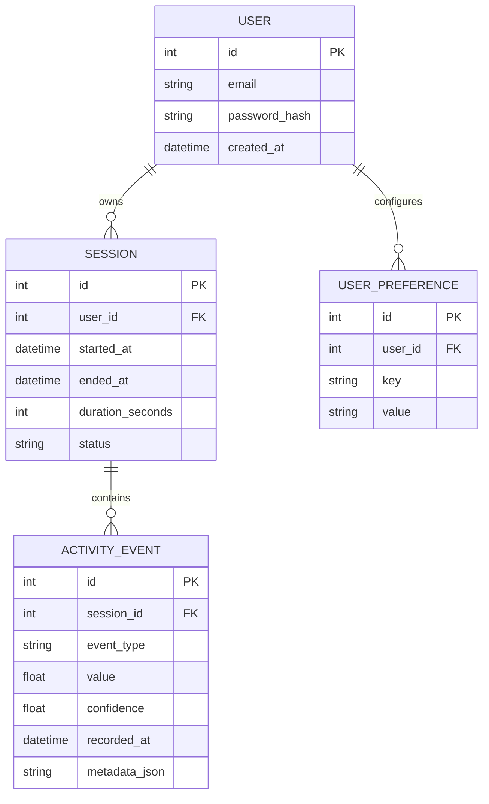

# FLOWSTATE — Architecture & Technical Design

## 1. Product definition

FLOWSTATE is a browser-first human activity analytics platform. It extracts a small set of observable visual signals (pose landmarks, face landmarks, movement and posture proxies), aggregates them over time, and presents understandable session insights.

It is **not** a mind-reading, emotion-recognition, medical, employee-surveillance or objective productivity-scoring system.

## 2. Design principles

1. **Privacy by default:** webcam frames stay in the browser. Only user-approved structured metrics/events are persisted.
2. **Evidence before inference:** every insight should point to observable metrics and carry confidence/limitations.
3. **Modular intelligence:** replaceable vision adapters, temporal analytics and recommendation rules.
4. **Graceful degradation:** the app remains useful when camera access or model downloads are unavailable.
5. **User agency:** clear camera state, explicit session start, pause/stop, data export/deletion path.
6. **No unsupported psychological claims:** no emotion or mental-state labels.

## 3. High-level architecture

## 4. Runtime data flow

## 5. Frontend modules

| Area | Responsibilities |
|---|---|
| `pages/Dashboard` | Aggregate metrics, recent sessions and recommendations |
| `pages/LiveVision` | Camera lifecycle, model initialization, local inference |
| `pages/Sessions` | Session list and session details |
| `pages/Insights` | Recommendation explanations |
| `pages/Privacy` | Explain processing, permissions and data controls |
| `components` | Reusable cards, charts, navigation and status components |
| `services/api.ts` | Authenticated API client |
| `vision/` | Model adapters and feature derivation |
| `hooks/` | Auth and camera-related hooks |

## 6. Vision pipeline

### Implemented signals

- Pose landmark presence and visibility
- Approximate shoulder alignment / upper-body lean proxy
- Face landmark availability
- Approximate head orientation proxy (landmark-based)
- Frame-to-frame upper-body landmark movement proxy
- Session activity duration and user-entered event labels

### Not claimed

- Clinical posture diagnosis
- Accurate eye gaze or attention measurement
- Emotion, stress or fatigue detection
- Reliable phone/object detection in this starter
- General-purpose activity recognition from arbitrary camera angles

Those require separate validated models, datasets, consent and evaluation.

## 7. Backend architecture

### Backend layers

- `app/api`: route definitions
- `app/core`: configuration, security and database setup
- `app/models`: SQLAlchemy entities
- `app/schemas`: request/response validation
- `app/services`: session, analytics and recommendation logic

## 8. Data model

## 9. API contract

Base path: `/api/v1`.

| Method | Endpoint | Auth | Description |
|---|---|---|---|
| GET | `/health` | No | Health check |
| POST | `/auth/register` | No | Create account |
| POST | `/auth/login` | No | Obtain JWT |
| GET | `/auth/me` | Yes | Current user |
| POST | `/sessions` | Yes | Start session |
| GET | `/sessions` | Yes | List own sessions |
| GET | `/sessions/{id}` | Yes | Session detail |
| POST | `/sessions/{id}/events` | Yes | Add compact event |
| POST | `/sessions/{id}/finish` | Yes | Finish session |
| GET | `/analytics/summary` | Yes | Aggregate metrics |
| GET | `/recommendations` | Yes | Explainable recommendations |

Ownership is checked on session operations. Clients must never be able to access another user's session by guessing an ID.

## 10. Analytics and recommendation logic

The starter uses transparent rules, not a black-box mental-state classifier.

Example:
- If a user has accumulated a long continuous session, suggest a voluntary break.
- If repeated posture proxy warnings occur, suggest adjusting the setup or changing position.
- If there is insufficient signal confidence, show “Not enough data” rather than guessing.

Recommendation records should include:
- Triggering metric
- Threshold/rule
- Plain-language explanation
- Suggested action
- Confidence / limitation

## 11. Security & privacy

- Camera is started only by explicit user action.
- Video frames are processed locally and are not uploaded.
- Backend stores compact user-approved event metrics only.
- Passwords are hashed with bcrypt.
- JWTs are signed using a secret from environment variables.
- CORS is configurable.
- Session ownership is enforced.
- Production must use HTTPS, strong secrets, managed DB, backups and monitoring.
- Users should be given a clear way to delete stored account/session data.

## 12. Performance strategy

- Run inference at a throttled frame rate rather than every display frame.
- Resize video before inference where supported.
- Keep rendering separate from inference state updates.
- Batch or aggregate events before sending to the API.
- Avoid continuous WebSocket video streaming.
- Use browser GPU/WASM delegate where supported, with fallback.
- Measure FPS, inference latency, memory and battery impact on target devices.

## 13. Roadmap

### Phase 1 — Functional foundation
Authentication, dashboard, camera permission, local pose/face inference.

### Phase 2 — Reliable measurements
Calibration, quality checks, temporal smoothing, confidence handling and test fixtures.

### Phase 3 — Behaviour analytics
Session timeline, event aggregation, historical baseline and explainable rules.

### Phase 4 — Research extensions
Dataset-backed activity recognition, object detection, model evaluation and fairness testing.

### Phase 5 — Production
PostgreSQL migrations, observability, security review, deployment and user testing.

## 14. Research and evaluation

Potential datasets to investigate (check licenses and terms):
- UCF101 — human activity recognition
- HMDB51 — action recognition
- MPII Human Pose — pose estimation
- COCO Keypoints — human keypoints
- AVA — spatiotemporal activity labels

Metrics:
- Pose: PCK / landmark error
- Object detection: precision, recall, mAP
- Activity recognition: macro-F1, confusion matrix
- Event detection: precision, recall, event latency
- Product: inference FPS, latency, CPU/memory, user-rated usefulness

Do not publish accuracy claims without an explicit dataset, split, protocol and measured results.

## 15. Extension points

- ONNX Runtime Web for custom browser models
- PyTorch service for heavier inference
- PostgreSQL for production persistence
- Redis / task queue for asynchronous processing
- Model registry and versioned model metadata
- User-controlled exports and deletion
- Optional LLM explanation layer grounded only in stored metrics
